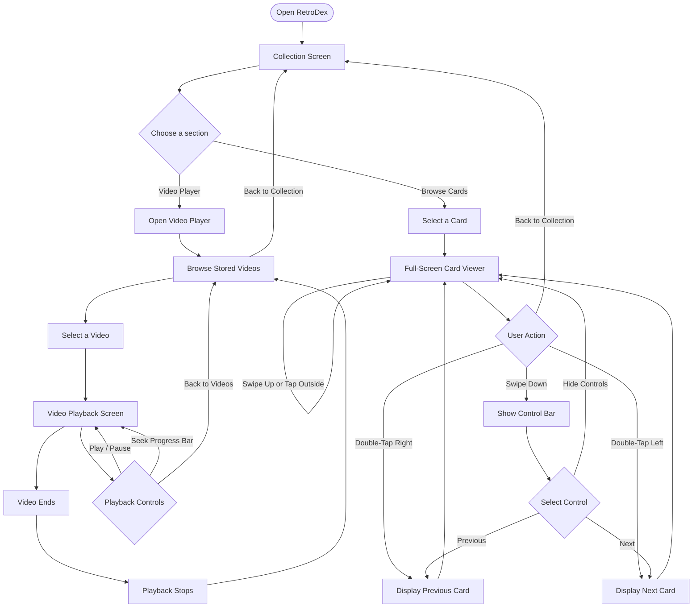
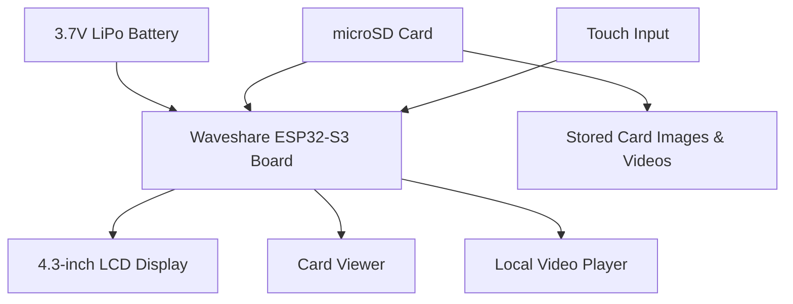

# RetroDex

**A pokedex-Inspired Digital Card Viewer**

> Project Version: V1  
> Device Target: 2 handheld units  
> Development Status: Design and Planning

## 1. Project Overview

RetroDex is a handheld digital card viewer designed to bring a retro-inspired experience to digital collectible cards.
The device uses a touchscreen interface to display digital cards, browse a card collection and navigate between cards using touch gestures.
RetroDex also includes a separate local video player for viewing videos stored on a microSD card.
The project is being designed around the Waveshare ESP32-S3-Touch-LCD-4.3 development board.

## 2. Project Objectives

- Create a fun PokemonDex style card digital viewer.
- The device is fully offline without any internet connection and runs fully offline. So, no distraction in this, no scrolls, just an actual play! 
- Allow users to browse and navigate through their card collection.
- Support local video playback without requiring an internet connection.
- Explore wireless card trading between devices in future development.

## 3. Planned Features

### 1. Digital Card Viewer
- Display digital cards in full-screen mode.
- Browse one card at a time.
- Double-tap the left side of the screen to move to the next card.
- Double-tap the right side of the screen to move to the previous card.
- Swipe down to reveal the Previous and Next control bar.
- Swipe up or tap outside the control bar to hide it.
- Use the Previous and Next controls to navigate between cards.

### 2. Local Video Player
- Store 3–4 video files locally on a microSD card.
- Play videos without requiring an internet connection.
- Provide touchscreen playback controls:
  - Play / Pause
  - Video progress bar and seeking
  - Volume control (if audio hardware is included)
- Stop playback when a video reaches the end.

### 3. Touchscreen Interface
- Provide a touchscreen-based interface for navigating RetroDex.
- Keep the card viewer and video player as separate sections.
- Make navigation simple and easy to use.
- Design the interface for the display's 800 × 480 resolution.

## Future Features

### 1. Bluetooth Card Trading
- Explore Bluetooth Low Energy (BLE) communication between two RetroDex devices.
- Allow users to exchange digital cards between devices.

### 2. Improved Card Management
- Add more card collections and categories.
- Explore options for organizing and managing cards.

### 3. Interface Improvements
- Improve animations and transitions.
- Add more visual customization options.
- Refine the overall user experience.

### 4. Additional Entertainment Features
- Explore more offline entertainment features.
- Consider additional media options based on hardware capabilities.

## 4. Hardware Components

The proposed V1 hardware is based on:

- Waveshare ESP32-S3-Touch-LCD-4.3 development board.
- 4.3-inch 800 × 480 touchscreen.
- 3.7V LiPo battery.
- microSD card for local storage.
- Custom 3D-printed enclosure.

See [BOM.md](https://github.com/anshsolstar/RetroDeX/blob/main/bom.md) for the component list, quantities, estimated prices and supplier references.

## 5. User Interaction Flow

## 6. Hardware Architecture

## 7. Software Interface Design

## 8. Development Status

RetroDex is currently in the design and planning stage.

The bill of materials and initial user interaction flow have been prepared. Hardware assembly, software implementation and physical testing are yet to be completed.

## 9. Future Improvements

- Wireless card trading between RetroDex devices using Bluetooth Low Energy (BLE).
- Additional card management features.
- Further interface improvements and functionality.

## 10. Project Documentation

- [Bill of Materials](https://github.com/anshsolstar/RetroDeX/blob/main/bom.md)
- User Interaction Flow
- Hardware Architecture
- Software Interface Design
